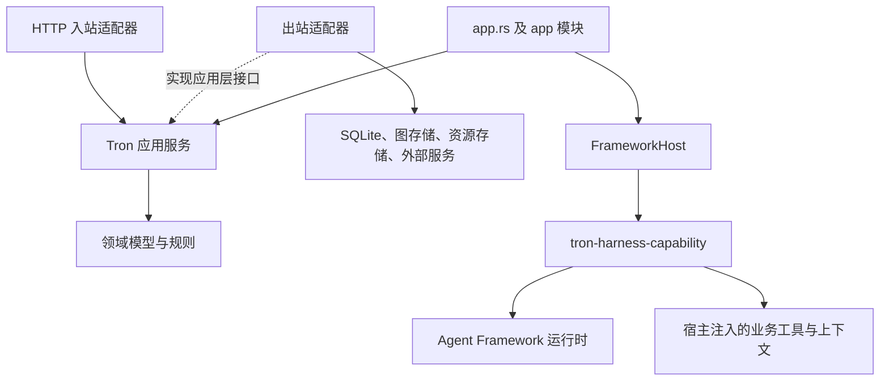
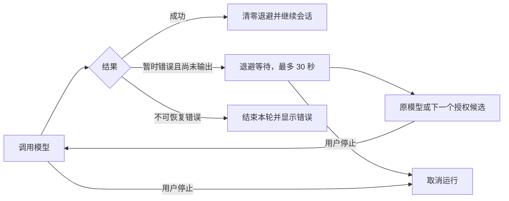

# 后端技术栈

本文说明当前后端的依赖、运行方式和职责划分。Rust 实现规则见[后端编码规范](spec/后端编码规范.md)，依赖版本以 [Cargo.toml](../Cargo.toml) 和 Cargo.lock 为准。

## 技术与职责

| 技术 | 当前用途 |
| --- | --- |
| Rust 2024、Cargo | 后端实现、依赖管理、构建与测试 |
| Tokio、Axum、Tower | 异步运行时、HTTP 路由、中间件与服务状态 |
| Serde、serde_yaml | JSON 序列化与 YAML 配置解析 |
| SQLite、rusqlite、tokio-rusqlite | 业务数据、身份登记及 Framework 本地持久化 |
| Grafeo | 嵌入式图存储 |
| OpenDAL | S3 资源存储适配；资源也支持本地文件存储 |
| EliteForge Agent Framework | Agent 运行、会话、工具执行、交互续跑及能力包装配 |
| socketioxide | 交互式终端的 Socket.IO 网关 |
| Framework PTY 后端 | 通过 portable-pty 提供伪终端进程，Tron 网关接入输入、输出与尺寸变化 |
| reqwest、PersonAI Rust SDK | 外部 HTTP 服务、模型及 PersonAI 接入 |
| utoipa、Scalar | 从代码生成 OpenAPI 文档并提供交互式预览 |
| Framework 可观测性插件 | 采集运行追踪与指标，提供查询及导出配置 |

## 代码与能力包

后端按 `domain`、`application` 和 `adapters` 分层，`src/app.rs` 及 `src/app/` 负责装配。Framework 运行逻辑由共享仓库提供，Tron 负责产品业务和宿主接入。



- `crates/tron-harness-capability` 的 Cargo 包名为 `tron-harness-capability`，运行时能力包 ID 为 `tron.harness`。
- 能力包装配工具插件、权限策略和上下文贡献器，并嵌入 `skills/` 下的主题、记忆、记忆整理与技能创建技能。
- Framework 仓库的 `crates/capability/eliteforge-agent-capability-development` 统一维护 Framework 对接、Agent UI 对接与 Agent UI 主题三个开发技能，包 ID 为 `eliteforge.agent-development`。Tron 直接通过 Git 依赖该开发能力包，与其他 Framework crate 使用相同版本来源，Cargo.lock 锁定具体提交。技能及完整资源编译进后端，默认安装并启用，启动时登记技能中心；启停与 Agent 授权沿用能力包资源管理。构建和运行无需同级 Framework 源码目录。
- Framework 开发技能携带 `tron-harness-cap-template` 生成器和完整模板。Agent 新建 Tron 能力包时，先运行生成器，再填写业务内容并构建。生成器需要 Node.js 22+，原生构建需要 Rust。模板源直接在 Framework 开发技能的 `assets/tron-harness-cap-template/` 维护，发布后通过更新 Tron 的 Framework 依赖随技能提供；不另注册模板能力包。
- 业务工具定义位于 `src/application/agent/tool_catalog.rs` 及同名目录；实现位于 `business_tools.rs` 及同名目录，由宿主注册和注入。能力包当前依赖这些宿主服务。
- 命令输出默认返回每路 16KiB 预览。stdout/stderr 分别报告当前页游标、后续内容、丢失字节及采集状态；进程完成不代表输出已读完。`captureToFile: true` 通过宿主的 `CommandOutputCaptureService` 独立保存原始输出，发布为当前会话附件 `fileRef`，沿用附件授权、容量限制与删除清理。默认上限每路 20MiB，资源配置更小时取较小值；空流不创建附件。文件写入或发布失败、容量超限均通过 `fileCapture` 明确报告。主运行和协作子运行均注入此服务。
- 通用本地工具、MCP、A2UI、AG-UI、模型与可观测性等能力由 Framework 的能力包或插件提供。具体装配见 `src/application/agent/framework_runtime/`。

Computer Use 能力包通过能力中心在线分发，用户自行下载安装，桌面应用不再随安装包内置能力包。Computer Use 包通过 Framework 原生 backend 协议贡献工具和技能接口，包进程直接调用内嵌 Cua Rust SDK，不注册 MCP 服务。提供 `framework.skills` 实现的包由其 SkillProvider 负责运行时元数据解析，声明的技能目录仍供技能中心登记和展示。电脑操作的工具和技能仅允许 `main-agent`、`main-assistant` 使用；该规则覆盖平台与工作区分配、默认继承、目录准入和执行时校验，既有的其他角色分配会在资源同步时清理。

外部 Agent 使用 `external_agent_pack(HostExternalAgent)` 的默认装配：绑定插件为 `framework.external-agent`，执行循环插件为 `framework.loop`，循环实现为 Framework 的 `ExternalAgentLoop`。Tron 注入的 `HostExternalAgent` 负责产品请求、结果及会话映射，CLI 协议由 Framework 的 external 实现插件处理。能力包工厂接收 `ExternalAgent` 契约实现，Framework 不依赖 Tron 类型。

CLI 模式的调用链：

```text
Framework ExternalAgentLoop
          | ExternalAgent 契约
          v
Tron HostExternalAgent（请求、结果、会话映射）
          v
Framework CLI 适配器 → Codex / OpenCode / dsh
```

dsh 的新会话统一归入原生工作区 `Tron harness`，工作区目录为业务数据库旁 `tron.workspaces/sessions`（默认 `~/.tron/tron.workspaces/sessions`）。普通聊天和协作调用使用同一配置。这个目录只用于原生会话分组；实际执行目录仍由 Tron 按项目、会话或 PersonAI 解析，再由 Framework external 插件在首轮模型请求前通过 dsh 的 `workingDirectory` 服务设置。AGENTS.md 与工具使用实际目录，沙箱的默认写入边界也保持为实际任务目录。已有非分组会话保留原目录续聊，不改写会话头或迁移到新组。

- Framework 运行时通过公开 Git 仓库 `https://gitee.com/person-ai/eliteforge-agent-framework.git` 引用，使用固定提交 `cc64db5fc23815b228fcc1870f2a4210ba6ce68c`（`1.0.0` 标签），Cargo.lock 与 Cargo 清单共同锁定该版本。开发技能包随该提交提供，内置模板的 Framework 依赖也使用 `1.0.0` 标签。构建无需本机 Framework checkout 或软链接。
- Person-AI SDK 通过 Framework 的 Git 依赖固定到已发布提交，锁文件记录实际版本；构建不依赖本机 SDK 路径覆盖。
- 语音输入通过 Framework 的 `SpeechRecognitionModel` 执行。Person-AI 适配调用 SDK 的实时 WAV 转写，SDK 负责鉴权、加密、TLS、并发收发及连接释放；其他已支持的 HTTP 供应商由 Framework HTTP 模型插件适配。Tron 只负责录音、身份和自动路由约束、请求取消与结果回填。

工具错误、超时、panic、MCP 传输失败以及权限检查、交互校验或结果处理异常，统一作为工具结果交给模型继续处理，不因此结束整轮运行。调用结果不确定时保留 `outcomeUncertain` 标记，提示模型先读取最新状态；框架不会自动重放该调用，并行批次中的其他工具也继续收集结果。权限检查失败时不会执行工具。

对话自动路由优先使用同一工作区、会话和 Agent 上次成功的模型；候选模型和授权每轮重新检查。普通会话、PersonAI 和内置协作 Agent 的模型调用遇到暂时性网络错误、限流或服务端错误时持续重试，不受模型配置中的有限重试次数约束。显式选择的模型重试原模型；自动选择的模型按当前授权且兼容的候选列表轮换，尝试完一轮后重新轮换。重试等待约为 2、4、8、16、30 秒，之后保持 30 秒，另加 Framework 自身不超过 1 秒的调度等待；一次成功后清零。

重试沿用同一 run，用户停止或父运行取消时可中断请求和等待。Framework 要求有限运行期限，会话采用可表示的 100 年期限，子运行仍受父运行期限约束。未显式配置模型输出额度时，`modelInvocation.defaultOutputTokens` 默认 65536，推理、正文和工具参数共享该额度；显式模型额度继续优先，调用费用取决于实际生成量。会话模型调用不设独立的总时长或空闲超时，慢速推理和网络等待可持续进行；用户停止和父运行取消仍可终止调用。Framework 要求有限的模型期限，因此沿用会话生命周期预算，父运行期限仍优先。PersonAI 模型返回 `finish_reason=length` 时，错误包含实际发送的 `max_tokens`，指向模型输出额度或默认输出额度配置；截断的工具参数不会执行。已有 `~/.tron/application.yaml` 的显式输出额度优先于新默认值；旧 `agentModelTimeoutSeconds` 字段被忽略，不再产生调用超时。鉴权恢复、配额耗尽、权限、配置、上下文溢出及已经输出内容后的失败仍遵循 Framework 的处理规则；配额耗尽的候选不会重新加入轮换。外部 CLI Agent 由其自身执行协议管理，不使用此重试策略。单次尝试失败保留诊断记录，整轮终止才产生运行失败事件。界面按运行 ID 将失败放回对应用户消息。



本地命令的 `sudo: true` 参数由 Framework 处理。Tron 注入会话与用户范围的 `SudoPasswordProviderService`，通过 `/api/v1/chats/sessions/{session_code}/sudo-inputs` 查询待输入请求，再向对应请求的 `/answer` 接口提交密码或 `null` 取消。请求要求 `X-Tron-Sudo-Input: 1`，仍经过原有工作区、PersonAI 或知识库范围校验，响应禁用缓存。密码仅在一次性内存通道中传递，不进入 native interaction、消息历史或遥测事件。子代理继承发起聊天的密码输入服务；前端通用聊天组件呈现密码框，关闭框会取消命令。

## Token 估算

通用的 `TextTokenizer`、`TokenizerRegistry`、匹配规则和精度标记由 Framework core 提供；HTTP 模型插件提供内嵌词表和默认注册表。Tron 只投影实际发送的消息、工具与协议字段，共享同一选择结果进行上下文装配、压缩和最终准入；不再在产品中维护具体模型枚举或词表。

```text
供应商实际模型名（忽略供应商路径，不使用目录 UUID）
  → 精确模型规则 → 不区分大小写的家族包含匹配 → Unicode 回退
  → 共享且按需加载的 TextTokenizer
  → 实际发送内容 + 协议开销估算 → 预算、压缩、准入
```

默认覆盖 Qwen、DeepSeek、GLM、Kimi、GPT 和 Claude/Opus。家族规则使用已固定的代表性词表，不代表所有版本的官方精确计数；已知具体模型的规则优先，宿主可克隆默认注册表后注册新分词器或覆盖模型规则。Qwen 3 与 3.5、GPT cl100k 与 o200k 分开选取。Opus 使用 Anthropic 发布的旧版词表作近似，不能视为当前 Opus 的官方 tokenizer。请求审计中的 `estimator` 区分已知模型词表、`family_estimate` 和其他估算；实际用量仍取供应商返回值。

词表和许可归 Framework HTTP 模型插件管理，运行时不联网下载；加载失败明确返回错误，不悄悄改用别的词表。导入 Hugging Face tokenizer 时关闭原文件中的 padding 和 truncation，完整计数长文本。注册和选路本身不解析词表，每个被使用的词表只加载一次，注册表副本共享已加载实例。

本地计数沿用词表的标准化、特殊 token 和预分词规则，按完整预分词片段累加数量，避免为了获取长度而保留整份 Encoding；自定义后处理器沿用完整编码。macOS 的 Makefile 开发入口与 Electron 后端启动器默认设置 `MallocLargeCache=0`，让已释放的大块临时缓冲及时退出分配器缓存；显式环境变量可覆盖。它必须在进程启动前设置，不修改 RSS 统计口径，也不释放仍被使用的词表或会话。

## 配置与存储

每个 `FrameworkHost` 统一持有一组 `LocalStorageRuntime` 服务，并提供应用生命周期内稳定的存储 Framework 入口。会话、历史、回放、短期记忆和 PersonAI 记忆读取共用这组对象与同一个数据库；回放不再单独创建生命周期存储。可重载的执行 Framework 通过 `storage.plugin()` 借用全部存储服务及扩展，不取得关闭权。

```text
FrameworkHost → LocalStorageRuntime → 原数据库
    ├─ 稳定存储入口 → 会话 / 历史 / 回放 / 记忆
    └─ 可重载执行 Framework → 借用同一组服务
```

能力包变更持有配置准入锁，并保留原有活动运行和持久引用检查；不强行终止运行以完成重载。需要访问可重载服务的请求和辅助运行持有读取租约，替换操作取得写入租约后才关闭旧运行时，避免新请求在变更中初始化另一代运行时。普通存储读取不依赖可重载实例，重载时继续可用。应用退出先排空运行并关闭所有借用 Framework，再关闭存储所有者，最后关闭宿主数据库；取消关闭调用的等待不会丢失实际清理任务。

通用设置使用明确的用户选项清单，展示外部 Agent 启动命令（3 项）、知识库图片授权与说明（3 项）、记忆与知识检索阈值（2 项）、上下文自动压缩与目标运行上限（3 项）。界面使用中英文名称，详情放在提示中；新增 YAML 字段不会自动成为用户设置。上下文顺序与预算在“上下文配置”页管理，连接池、事件总线、存储、加密和内部容量参数留在配置文件中。

当前文档解析由 `PersonAiDocumentParser` 装配；旧 MinerU 服务地址、节点、OCR 和默认档位不控制该解析链路，不在通用设置展示。知识库图片说明、视觉上下文及入库队列仍读取 `mineru` 下对应配置，不能整段删除。已无消费者的 `parseEndpoint`、`backend`、`parseMethod`、`returnContentList` 与资源限制 `schemaMaxBytes`、`maxDepth`、`maxValidationErrors`、`maxBinaries` 已从配置模型和初始化模板移除；读取配置管理接口时清理旧文件中的这些字段。

```text
配置文件 → 有效运行配置 → 服务装配
                    └→ 用户选项清单 → 通用设置（11 项）
                    └→ 上下文配置页 → 顺序与预算
```

正式启动入口 `src/main.rs` 通过 `AppConfig::from_application_yaml()` 读取配置，默认文件是 `$HOME/.tron/application.yaml`。首次启动缺少默认文件时，后端从内嵌模板创建目录和配置，并生成独立的加密密钥；已有文件不会被覆盖。`TRON_BACKEND_APPLICATION_CONFIG_PATH` 可指定其他配置文件，该文件必须已存在。显式指定默认路径时仍会自动初始化。macOS 和 Linux 桌面端与 Web 模式共用此流程；打包的 Windows 桌面端使用自己的数据目录和配置初始化流程。

配置按“运行时默认值 → YAML → 已支持的环境变量”依次覆盖。环境变量覆盖项由 `src/config.rs` 和 `src/config/` 明确定义；不能根据 YAML 字段名推断出任意环境变量。

通用设置按有效配置展示 `systemAgents.codexCommand`、`systemAgents.opencodeCommand` 和 `systemAgents.dshCommand`，即使 YAML 未写出这些字段；读取设置不把默认值写回文件。默认命令分别为 `codex`、`opencode`、`dsh`，修改后重启生效。`dshCommand` 留空停止扫描，默认命令在 macOS 的 PATH 中不可用时会检查 DeepSeek Harness 桌面安装包。

| 配置项 | 默认值或说明 |
| --- | --- |
| HTTP 地址 | `127.0.0.1:8080`；支持 `TRON_BACKEND_BIND_ADDRESS`、`TRON_BACKEND_PORT` |
| 业务 SQLite | `$HOME/.tron/tron.sqlite3`；支持 `TRON_BACKEND_DATABASE_URL` |
| 身份登记 SQLite | `$HOME/.tron/control/profiles.sqlite`；由 `ProfileRegistryService` 单独读取 `TRON_BACKEND_CONTROL_DATABASE_URL` |
| 图存储 | `$HOME/.tron/tron.graph.grafeo`；支持 `TRON_BACKEND_GRAPH_STORAGE_PATH` |
| 外部技能注册目录 | `$HOME/.tron/skills-registry`；对应 YAML 的 `skillsRegistryRoot` |
| 本地资源目录 | `$HOME/.tron/resources`；通过 YAML 的资源存储配置调整 |
| 前端静态资源 | 后端 crate 下的 `resources/frontend`；支持 `TRON_BACKEND_FRONTEND_DIST_DIR` |
| 普通终端默认目录 | `.`；支持 `TRON_TERMINAL_WORKING_DIRECTORY` |

身份登记库保存 PersonAI 身份和当前激活身份，与业务库分开配置。受保护的业务路由通过 `require_profile` 获取当前身份；现有请求上下文沿用历史类型名，但该中间件不执行本地登录或 Bearer token 校验。

代码仓库连接属于全局配置。已认证用户可以管理连接并在各空间的主题中使用它；令牌加密保存，接口不返回令牌。原有连接保留其加密上下文，以便继续读取已有凭据。

数据库初始化统一定义在 `migrations/0001_init.sql`，按业务库和身份登记库分区执行。首次打开时在事务中创建最终表结构、索引、触发器和内置目录，并记录初始化完成；再次打开只检查标记，不重置用户数据。当前处于初期开发阶段，不提供旧数据库升级或数据迁移。

```text
SharedDatabase::open       → schema::initialize_business → 业务库区段
ProfileRegistryService::new → schema::initialize_profiles → 身份登记库区段
```

Framework 自有表仍由 Framework 存储插件初始化；RAG 按语料配置创建的动态全文、向量索引仍由运行时维护。

SQLite 中文分词和向量扩展复用 Framework 本地存储插件的 `bundled-native` 功能，原生库及字典按编译目标嵌入后端二进制，运行时由插件校验并释放到缓存目录。Tron 仅保留环境配置和连接生命周期适配，桌面打包无需复制 `resources/native`。

```text
Tron SQLite 连接 → ExtensionConfig → Framework 内嵌资源 → 校验及缓存 → 中文分词、向量查询
```

当前只面向 macOS、Linux 和 Windows。Framework 现有资源同时支持中文分词和向量查询的目标为 macOS x86_64/arm64、Linux GNU x86_64/arm64、Windows x86_64；Windows arm64 和 Linux musl 尚未配齐这两类资源。`TRON_SQLITE_EXTENSION_MODE` 支持 `disabled`、`preferred`（默认）和 `required`；`TRON_SQLITE_EXTENSION_RUNTIME_DIR` 指定缓存目录，默认是系统临时目录下的 `tron/sqlite-extensions`。

知识库解析产物使用独立的正文预算：移除图片二进制数据后的规范化文本最多 16 MiB，长文档最多 10,000 个分块，超限明确失败且不截断正文。原始解析产物仍受 100 MiB 预算约束；本地纯文本上传保持 2 MiB 限制。

## HTTP 与前端资源

- 产品 JSON 响应使用 `ApiResponse<T>`，字段为 `code`、`message`、`data`。普通成功响应的 `code` 为 `SUCCESS`；部分协议适配使用 `protocol_success` 返回 `0`。SSE、文件下载和 Socket.IO 遵循各自的传输格式。
- 请求语言由 `Accept-Language` 解析为 `zh-CN` 或 `en-US`，缺省或不支持时使用中文。用户可见文本统一经 `tron-i18n`（`crates/i18n`，rust-i18n `_version: 2`）从 `locales/*.yml` 读取，业务代码只引用语义化 Key；`make be-i18n-check` 校验资源完整性与 Key 引用，CI 执行同一检查。
- `/api/docs` 提供 Scalar 预览，`/api/openapi.yaml` 提供 YAML。当前 OpenAPI 只登记健康检查、就绪检查及可观测性接口，尚未覆盖全部业务路由。
- `make openapi` 从 `src/openapi.rs` 导出仓库根目录的 `openapi.yaml`，不代表执行了完整 API 契约验证。
- Axum 可同时提供 API 和构建后的前端资源。静态文件必须存在于配置目录；前端页面路由回退到 `index.html`，`/api` 路径不参与页面回退。Vite 开发模式由单独进程提供页面并代理 API。

`POST /api/v1/directories/pick-path` 接收 `{ workspaceCode }`，打开执行机器的系统文件夹选择窗口，成功响应的 `data` 为 `{ path }`，取消时 `path` 为 `null`。此接口只选择路径，不登记工作区；原有 `/directories/pick` 仍负责选择并登记。两者共用本机来源、回环连接与 `X-Tron-Native-Picker: 1` 校验，并按 `Accept-Language` 显示窗口标题。主题克隆选择父目录后由前端追加仓库名，提交准备操作时才创建新的检出目录。

HTTP 入口通过 `into_make_service()` 在启动时展开路由，避免每条连接重复装配路由。`AppState` 通过 `Arc` 共享服务和配置，请求提取状态时只复制引用；宿主初始化时显式替换服务采用写时复制，保持各宿主的配置隔离。

观测看板的 `diskUsage` 统计 Tron 本地数据：默认覆盖 `~/.tron`，同时纳入配置在外部的数据库、图存储、技能和本地资源路径。自定义 YAML 位于代码仓库时，只统计配置文件及明确的数据路径，不扫描整个仓库。扫描在后台执行，结果缓存一分钟；初次采集或读取失败时 `bytes` 为 `null`。Unix 按文件系统已分配块计数并去重硬链接，其他平台按文件长度计数；路径重叠去重，不跟随目录内软链接。该值独立于工作区筛选，不包含远端存储。

```text
看板请求 → 返回缓存快照
             └─ 未采集或缓存过期 → 单次后台扫描 → 更新快照
```

## 终端与命令执行

普通交互式终端先通过 REST 取得连接票据，再连接 Socket.IO。票据有效期为 60 秒，消费后立即删除。当前票据保存在后端进程内存中，多实例部署时，票据签发与 socket 连接必须到达同一实例。

票据包含 `appCode` 时，服务检查应用所属工作区和启用状态，并使用 `App.localDirectory`；不包含时使用配置中的普通终端目录。PTY 进程由 Framework 后端持有。

Agent 文件与命令工具和外部子代理共用同一份执行目录。选定应用/worktree 时使用其目录；无项目会话使用数据库旁 `tron.workspaces/sessions/<用户>/<会话>`，PersonAI 使用 `tron.workspaces/assistants/<用户>/<Assistant>`，目录随首次执行创建并跨运行保留。主代理能在执行上下文中看到实际 `localDirectory`。`agent_spawn`、`thread_create` 的 `workingDirectory` 指定子任务目录，省略时继承父目录；相对路径基于父目录解析，并保留父代理原有的文件访问权限。独立 Thread 续聊保持最初绑定的目录。显式目标缺失时仍应报错，不能借用普通终端的默认目录规则回退到后端进程目录。

删除归档会话时，清理会话记录、附件和该会话在 `tron.workspaces/sessions/<用户>/<会话>` 下的专属目录；项目仓库和 PersonAI 共用目录保留。目录在会话记录删除的同一事务内先重命名为 `.deleting-*` 占位，重命名失败会回滚整次删除；事务提交后再异步删除占位目录内容，附件文件同样在响应返回后清理，因此目录大小和磁盘 I/O 不阻塞删除请求，也不在写事务内长时间持有数据库写锁。历史链路、日志和观测统计独立保留，删除会话不访问遥测数据库，也不重算历史统计。

主题归档覆盖该主题的全部会话；目录归档覆盖同工作区、同执行机器下的本目录和已登记子目录，以及按位置归属这些目录的全部会话。删除使用同一范围，并包含已归档会话；主题关联、目录登记随容器删除。永久删除还会删除磁盘原目录及其中全部文件（包含未登记子目录）；主题删除收集其目录引用、会话执行目录和关联应用的本地目录。若路径被范围外的主题、会话或应用共用，整批拒绝并提示解除引用；不通过清空引用来绕过共享检查。

容器操作持有运行准入与会话仓储锁，写事务内重新检查目录、会话范围和活动目标；有运行中的会话或范围变化时整批拒绝。批量删除先暂存会话专属目录及原始项目根目录，数据库失败时恢复，提交成功后清理暂存目录及附件；拒绝系统根目录、用户主目录、Tron 数据目录、服务当前目录及其祖先、发生软链接替换的路径。暂存目录清理失败会返回失败并记录错误和路径。恢复主题内的归档会话时同步恢复主题。


## PersonAI 工具契约

PersonAI 对话保持平台级会话归属；每条用户消息独立携带发送时选中的工作区及页面位置。后端校验工作区存在且启用后，在执行上下文中记录 `workspaceCode`、`workspaceName` 和 `pageContext`。业务工具使用这份执行工作区；会话存储、附件、PersonAI 记忆和本人任务仍使用原归属。页面位置本身不授予工作区或文件访问权限，也不会自动绑定页面关联的应用目录。

```text
发送时选择的工作区 → 后端校验 → 本轮执行上下文 → 子代理 / Thread 继承
平台级会话归属     → 会话历史、附件及 PersonAI 自有记忆保持原范围
```

普通新消息重新采集工作区；交互恢复和目标续跑保留原轮次快照。已创建 Thread 的后续运行沿用其绑定上下文，浏览器切换空间不会更改正在执行的授权范围。

PersonAI 使用 `assistant_task_*` 和 `assistant_memory_*`，不以普通工作区工具替代。记忆范围仅为当前用户和工作领域，不接收 `workspaceCode`；工具列表与执行权限在同一次运行中使用相同的分配快照。新运行或交互续跑重新读取配置，在 Framework 会话事件中保存目录版本，向模型注入新增、移除工具及重新发现 schema 的提示；不在工具执行中途替换目录。

```text
保存工具分配 → 新运行 / 交互续跑 → 重新准入 → 比较会话内目录版本
                                             └─ 有变化 → 提示模型新增 / 移除的工具
```

`assistant_notification_page/get` 按当前 PersonAI 和用户绑定查询通知，返回当前已读、解决、归档时间；无浏览器或推送回执时，`delivery.received/pushed` 为 `null`。`assistant_notify` 的首次标题、正文原样落库；相同 changeId 和内容重试复用原收据，内容不同返回 `NOTIFICATION_CONTENT_CONFLICT`，不改写或重发通知。归档或删除通知后重试也不会重建通知。

`task_get` / `assistant_task_get` 及更新结果返回实际流程的 `taskFlow.statuses`。DEFAULT 状态为 `NOT_STARTED`、`IN_PROGRESS`、`REOPEN`、`CLOSED`，自定义流程使用自己的状态；当前只校验流程成员，不声明迁移图。非归档 CLOSED 任务用更新工具指定合法非关闭状态即可重开，省略进度时重置为 0，并恢复后续调度。归档任务先恢复；关闭任务仍不可追加 Progress/Blocked。

同任务的具体成果继续按指纹去重。不同成果但摘要高度相似时，`assistant_work_change` 返回 `SIMILAR_WORK_CHANGE` 和已有事项、通知编号供模型检查，不自动合并或发送通知。

统一 RAG 使用 `application.yaml` 的 `ragRetrieval.minVectorSimilarity` 和 `ragRetrieval.minRerankScore`，向量阈值初始为 `0.55`，重排阈值初始为 `0.5`；应按所用模型、接口分数含义和业务样本校准。配置管理接口保存后在下一次检索生效。向量阈值按余弦相似度筛选候选，取值为 0 到 1；重排阈值按所选模型的原始相关分筛选，取有限非负数，分数不代表置信概率。`null` 关闭对应门槛。融合排名分只决定顺序，不用于相关度判断。

重排成功时，仅返回达到重排门槛的结果；合法的空结果保持为空。未配置重排、调用失败或响应无效时，降级结果仍需通过向量门槛；启用该门槛时，没有向量相似度的全文或图谱候选不进入降级结果。数量参数始终是上限，不用弱匹配补满。结果的 `source.relevance` 分别提供 `vectorSimilarity` 和 `rerankScore`，便于用相关与无关样本校准阈值。无相关性问题的空查询保留结构化筛选行为，不应用相关度门槛。检索阶段提供 `vector_relevance` 和 `relevance_filter` 的结果数量；上游失败保留诊断，对话可继续。

## 开发与验证入口

以下命令均在仓库根目录执行：

| 命令 | 用途 |
| --- | --- |
| `make be-check` | 检查后端编译 |
| `make harness-capability-check` | 单独检查 Tron Harness 能力包 |
| `make be-dev PORT=8080` | 启动后端，并加载存在的 `tron-backend/.env` |
| `make dev-api` | 启动后端与 Vite API 联调环境 |
| `make web-build` / `make web-dev` | 构建前端静态资源与后端，或构建后启动统一 Web 服务 |
| `make openapi` | 导出当前已登记的 OpenAPI 内容 |

## 应用日志

日志使用 `tracing`、`tracing-subscriber` 的标准 JSON 格式和 `tracing-appender` 的每日轮转，不维护应用日志缓存。文件位于 `application.yaml` 同级的 `logs/tron-backend.YYYY-MM-DD.jsonl`，按 UTC 日期切分。库在启动和轮转时自动清理旧文件，默认最多保留 30 个文件，可用 `TRON_BACKEND_LOG_MAX_FILES` 配置（1–3650）。`RUST_LOG` 控制采集级别；默认 `info,hyper=warn,reqwest=warn`。桌面端设置 `TRON_BACKEND_LOG_STDERR=false` 避免把同一批结构化日志重复写入旧的控制台捕获文件；原始启动失败和桌面进程生命周期信息仍由桌面端捕获。

`POST /api/v1/observability/logs/query` 接收用户日期、IANA 时区、级别、关键字和完整 Trace/Span ID。默认时区为 `Asia/Shanghai`，默认日期是该时区的当天。查询换算用户当地一天的实际时间范围，按需合并 UTC 每日文件，兼容夏令时 23/25 小时的日期，流式扫描后仅返回所选分页。连续日志视图通过 `beforeLogId`（文件名与数字行号）读取更早记录，新日志追加不会移动历史翻页边界；前端按写入顺序从早到晚展示完整内容，并在跟随模式下刷新已加载的连续范围。文件不会因后端重启清空。旧的 `tron-backend.log` 是桌面端捕获的文本文件，不作为新结构化查询的数据源。

用户菜单的昵称、套餐、剩余积分和签到状态按 PersonAI 用户 ID 缓存在身份登记库的 `profile_account_cache` 表。后端启动后立即同步，之后每 60 秒查询远端；授权完成、切换账户和签到完成会唤醒同步。远端失败或超时保留已保存的快照，不将未知值写成零。

`GET /api/v1/bootstrap/status` 和 `GET /api/v1/account/checkin` 只读本地表，不再随菜单打开访问远端。前端全局每 15 秒读取本地快照，侧栏和弹框共享同一份状态；关闭、重开弹框不重置数据。签到仍通过远端提交，成功收据先落库，再后台刷新真实余额，不将奖励加到旧余额上推算。签到按 PersonAI 的东八区自然日判断，旧日状态返回 `null`，与用户界面时区无关。

```text
启动 / 每分钟 / 账户操作 → 同步远端 → 身份登记库账户快照
                                          ↓
                        每 15 秒本地读取 → 侧栏与用户菜单
```

用户菜单中的时区偏好按 PersonAI 用户 ID 保存在身份登记数据库 `profile_preferences` 表中，默认 `Asia/Shanghai`。引导接口返回时区，修改接口保存成功后刷新整个页面。后端时间统一存储 UTC，前端页面时间与日志日期筛选使用该用户时区。

时间处理链路：

```text
用户时区 ──保存──> profile_preferences
UTC 时间戳 ──接口──> 前端按用户时区格式化
日志当地日期 + 用户时区 ──> UTC 时间范围 ──> 对应 UTC 每日日志文件
切换时区 ──保存成功──> 整页刷新 ──引导读取──> 新时区重新渲染
```

观测看板的“重置统计”调用 `POST /api/v1/observability/reset`。确认后清空所有工作区的历史链路、Span、指标及关联属性和汇总表，不受页面工作区筛选影响。服务先刷新待导出的后端遥测，再通过 Framework `TelemetryStore::clear` 在单个事务中批量删除子表和主表；采集器继续写入新数据。该操作不可撤销，不删除聊天业务记录或应用日志文件。

```text
确认重置 → 刷新待导出遥测 → 事务清空八张观测表 → 刷新前端查询 → 自动采集新数据
```

## Agent 与 PersonAI 执行次数

Agent 与 PersonAI 共用执行策略。`maxSteps`、`maxToolCalls` 默认 `0`，表示不限制；
正整数表示每次 run 的上限，`maxParallelToolCalls` 必须为正整数。前端留空保存为 `0`。
运行适配层把 `0` 转换为 Framework 的 `RunLimits::UNLIMITED_COUNT`，不能直接传入 SDK。
记忆整理 PersonAI 同样读取定义中的策略。已有显式配置继续生效，编辑时可清空两个次数上限。
等待回答或审批后的恢复沿用原 run 的检查点和额度；新消息启动的新 run 从零计数。

## 主题名称与归档

同一工作空间的未归档主题名称唯一，归档主题不占用名称。数据库使用 `idx_projects_active_name` 部分唯一索引，创建和重命名在写事务内检查冲突；已有未归档主题重名时返回明确的名称冲突。

恢复归档主题或恢复其会话时，在同一写事务内检查名称。若名称已被新主题使用，保持旧主题和会话的归档状态，提示先重命名当前同名主题。恢复操作不合并主题、重绑会话或改写原名称。

```text
创建 / 重命名 → 写事务 → 检查未归档主题名称 → 保存
恢复主题 / 会话 → 写事务 → 名称空闲 → 恢复原记录
                           └─ 名称已占用 → 回滚并提示冲突
```

工作区项目按工作空间、执行机器和规范化目录路径登记，显示名称不要求唯一。不同路径可使用相同显示名称；重新添加原目录会恢复原登记，保留原名称和关联身份，其已归档会话仍需单独恢复。
